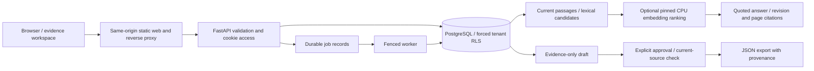

# Architecture and current capabilities

VeriCommerce AI stores evidence before producing content. The current release runs a React/TypeScript interface, FastAPI API, PostgreSQL database, durable worker and pinned CPU embedding model on one existing server. Training and external-store publishing are outside its current execution path.

## Access and persistence

An opaque HttpOnly, Secure, SameSite cookie selects a temporary isolated workspace. Only its token hash is stored. Its configured lifetime is 12 hours; the worker removes expired workspace data. Clearing cookies loses access and does not itself immediately delete server data. Persistent accounts, account recovery and team roles are not integrated.

Every tenant transaction sets a local tenant context. Forced PostgreSQL row-level security complements application filters. The runtime role is neither superuser nor BYPASSRLS; migration uses a separate administrator. API/worker do not receive a Docker socket or administrator DSN. PostgreSQL explains owner/superuser exceptions, which is why restricted-role checks matter: [row security](https://www.postgresql.org/docs/current/ddl-rowsecurity.html).

Configured origin, JSON body, request-rate and workspace quotas restrict writes. Limits cap admission/storage, not simultaneous-user capacity. Reverse-proxy trust is explicitly bounded; an observed edge address is not automatically the original visitor.

## Evidence lifecycle

1. JSON import validates product/source references and enqueues a durable job.
2. The worker upserts supplied records; omission is not deletion.
3. Exact replay preserves current revision. Changed source content creates an immutable revision linked to its predecessor.
4. Current passages remain connected to product, source revision, page and evidence text.
5. Drafts retain their original citations. Source or product-metadata changes invalidate dependent drafts.
6. Approval rechecks current evidence under transaction protection; stale/unapproved export is rejected.

Graph relationships represent product evidence, documenting sources, draft derivation and source supersession. They support lineage and impact inspection; they are not a trained graph model or community-summary GraphRAG implementation.

## Retrieval and answer behavior

PostgreSQL text search establishes candidate subject relevance. Quantized ONNX embeddings add local ranking through reciprocal rank fusion. Dense similarity alone cannot authorize a factual answer; lexical subject matching remains required. This protects against unrelated semantic neighbors but can reduce purely semantic recall.

Answers are retrieved quotations with explicit citations. Absence of relevant evidence produces abstention. A quotation can still answer only part of a question: provenance is not complete entailment verification. Drafts use evidence-only templates; no open-ended paid language-model completion runs here.

The exact public encoder repository/revision/file is configured and cached. Normal startup does not download a replacement. Missing cache produces an honest lexical-only status. See [data/models/evaluation](DATA-MODELS-EVALUATION.md).

## Durable jobs and failure boundaries

PostgreSQL holds queued/running/succeeded/failed state, leases and bounded retries. Before executing, completing or failing work, the worker checks the claimed attempt under a row lock. A resumed superseded worker cannot overwrite another attempt's result. This is fencing within the database; it is not distributed exactly-once publishing.

Containers separate web, API, worker and database, with resource limits, nonroot users, read-only roots and narrow writable paths. Database/cache volumes persist across image changes. A schema change requires compatibility review; image rollback does not undo an incompatible migration.

One server remains one failure domain. No multi-region failover, broad workload benchmark or continuous availability measurement is claimed. Recovery evidence and unverified schedule/RPO/RTO are described in [operations](OPERATIONS.md).

## Extension boundaries

The [roadmap](BUILD-PLAN.md) adds durable identity, permitted Shopify access, bounded document/image ingestion, comparison/context tooling, richer graphs, guarded publishing and training. Proposed AWS/GCP/Azure roles stay outside the primary critical path. Their code or planning does not count as an actual cloud deployment. Future large-scale design is specified separately in [scalability](SCALABILITY-AND-COST.md).
