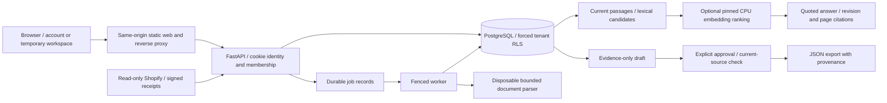

# Architecture and current capabilities

VeriCommerce AI stores evidence before producing content. Current release `20261018-phase3-01` follows the integrated expansion `20261018-phase1-01` and the verified 2026-10-15 evidence release. It runs accounts, uploads, retrieval/context inspection, temporal content review and read-only Shopify integration on the existing React/TypeScript, FastAPI, PostgreSQL, durable-worker and pinned CPU embedding stack. Current parity passed 228 artifact hashes, eight HTTPS checks and four healthy services. The prior expansion's 46 live browser checks are retained historical evidence; current store flows were verified separately. These integrated deployments carry phases 1–5 features, rather than five separate phase deployment receipts. Provider and recovery acceptance are recorded in [release evidence](RELEASE-VERIFICATION.md). Training and external-store publishing remain outside this execution path.

## Access and persistence

Temporary browser workspaces use an opaque HttpOnly, Secure, SameSite cookie; only its hash is stored. Their default lifetime is 12 hours and the worker removes expired temporary data. Clearing cookies loses access without immediately deleting server data.

Separate account sessions and persistent workspace memberships are deployed. Salted scrypt password hashes, bounded password concurrency, login attempt limits and session limits protect the identity boundary. Owners read/edit/approve/manage memberships and the connector; reviewers read/approve, editors read/edit and viewers read. Persistent data survives logout/session expiry. Email verification, automated recovery and invitation delivery are not implemented.

Account identity and current membership select the tenant. `X-Workspace-ID` lets a browser tab reject requests after another tab changes its active workspace; it is an expectation, never an authorization credential. Protected mutations recheck permissions under the tenant lock so membership revocation serializes with writes. Identified reviewer accounts are required for image, relation and benchmark approvals.

Every tenant transaction sets a local tenant context. Forced PostgreSQL row-level security complements application filters. The runtime role is neither superuser nor BYPASSRLS; migration uses a separate administrator. API/worker do not receive a Docker socket or administrator DSN. PostgreSQL explains owner/superuser exceptions, which is why restricted-role checks matter: [row security](https://www.postgresql.org/docs/current/ddl-rowsecurity.html).

Configured origin, JSON body, request-rate and workspace quotas restrict writes. Limits cap admission/storage, not simultaneous-user capacity. Reverse-proxy trust is explicitly bounded; an observed edge address is not automatically the original visitor.

## Evidence lifecycle

1. JSON/CSV catalog imports validate product/source references and enqueue durable jobs; catalogs can initialize empty account workspaces.
2. The worker upserts supplied records; omission is not deletion.
3. Exact replay preserves current revision. Changed source content creates an immutable revision linked to its predecessor.
4. Current passages remain connected to product, source revision, page and evidence text.
5. Drafts retain their original citations. Source or product-metadata changes invalidate dependent drafts, and source revisions retire dependent relationship/image approvals.
6. Approval rechecks current evidence under transaction protection; stale/unapproved export is rejected.

PDF and static PNG/JPEG/WebP uploads attach to existing products. Parsing occurs in disposable processes with memory/CPU/wall-time/text/result limits and bounded JSON IPC. Active/encrypted PDFs, animated images, MIME mismatches and oversized inputs fail closed. Text-bearing PDF pages become attributable passages; scanned/empty pages and raster images require OCR or reviewer observation. No OCR/vision model is executed by this path.

Source deletion tombstones current evidence, clears associated uploaded original bytes and invalidates dependent approvals. Extracted historical revisions/citations remain available for lineage; this is not complete historical erasure. Generation checks stop queued old imports from silently restoring changed/deleted evidence. Exact replay deduplicates rather than creating a new logical source revision.

The original graph endpoint retains evidence/draft/supersession lineage. Additional tables store typed candidate/approved/stale relationships, temporal validity and transitive impact inspection. Approval requires current supporting evidence. Normalized scalar contradictions and curated critical technical claims block drafts; these deterministic checks do not prove general factual entailment. Graph summaries or measured graph-retrieval improvements are not claimed.

Description/FAQ drafts quote source evidence. Product/ProductGroup JSON-LD is generated deterministically with field provenance and missing/conflicting offer, visible metadata and variant checks. Missing price/currency/availability blocks output; image observations never supply those facts. Purpose-aware image review distinguishes decorative, informative and functional uses, records the reviewer, and keeps alt text separate from verified technical attributes.

## Retrieval and answer behavior

PostgreSQL text search establishes candidate subject relevance. Quantized ONNX embeddings add local ranking through reciprocal rank fusion. Dense similarity alone cannot authorize a factual answer; lexical subject matching remains required. This protects against unrelated semantic neighbors but can reduce purely semantic recall.

Answers are retrieved quotations with explicit citations. Absence of relevant evidence produces abstention. A quotation can still answer only part of a question: provenance is not complete entailment verification. Drafts use evidence-only templates; no open-ended paid language-model completion runs here.

The exact public encoder repository/revision/file is configured and cached. Normal startup does not download a replacement. Missing cache produces an honest lexical-only status. See [data/models/evaluation](DATA-MODELS-EVALUATION.md).

The context API separately compares keyword, dense, hybrid and deterministic reranking. Tenant/current-source/product/SKU/color/category constraints apply before model computation. Its authorized trace includes context budget, selected/excluded passages, source authority, snapshot hash and a versioned cache key. Requested unavailable methods report unavailability rather than substituting another method. Frozen synthetic results select keyword for that corpus only; they establish no general hybrid gain.

## Shopify boundary

The connector permits only `read_products`. Single-use expiring OAuth state binds browser, account session, selected workspace and shop; callback HMAC and returned shop identity are checked. Encrypted credentials bind workspace/shop; refresh/expiry, bounded pagination/throttling and a pinned API version are explicit transport concerns. Real OAuth installation and initial development-store synchronization passed: 23 parents and 38 variants produced 61 products, 23 sources and 206 passages. Actual SKU/color constraints selected the intended child evidence and returned a cited answer. A three-citation FAQ was blocked from preapproval export, then approved and exported with unchanged text and no publishing. Review was performed by the delegated agent. Actual incremental webhook delivery remains distinct from registration and local replay/order tests.

Normalized parent products retain catalog/media observations. Stable variant child products carry exact SKU and authoritative named Color options; titles/images cannot infer color. Parent-plus-SKU/color selection exposes only eligible child passages to retrieval. Removed/deleted/uninstalled products are tombstoned; their drafts, relations and image approvals become stale while historical identifiers/citations remain. Manual input cannot overwrite the provider namespace or attach a manual child to a provider parent.

Webhooks verify raw-body HMAC and commit durable receipts with their effects before acknowledgment. Duplicate delivery IDs are idempotent and older records cannot resurrect newer deletions. Local disconnect clears tokens; it does not assert remote uninstall/revocation. No Shopify write transport is included.

## Durable jobs and failure boundaries

PostgreSQL holds queued/running/succeeded/failed state, leases and bounded retries. Before executing, completing or failing work, the worker checks the claimed attempt under a row lock. A resumed superseded worker cannot overwrite another attempt's result. This is fencing within the database; it is not distributed exactly-once publishing.

Fair tenant scanning covers persistent and temporary workspaces without allowing a busy early tenant to starve the unvisited tail. Explicit manual retries retain the original attempt budget and cannot replay successful/running jobs or restore deleted uploads. Shopify reads use bounded synchronous provider transactions rather than the durable import worker.

Containers separate web, API, worker and database, with resource limits, nonroot users, read-only roots and narrow writable paths. Database/cache volumes persist across image changes. A schema change requires compatibility review; image rollback does not undo an incompatible migration.

The current populated off-server recovery reproduced all 26 tables and their payloads from an authenticated AES-256-GCM archive, verified restricted-role isolation, and left the primary unchanged. An actual rollback/forward preserved three approved drafts and persistent volumes, with final 228-artifact parity. These are rehearsals; scheduled recovery, retention and ongoing RPO/RTO compliance remain unestablished. One server remains one failure domain. No multi-region failover, broad workload benchmark or continuous availability measurement is claimed. See [operations](OPERATIONS.md).

## Extension boundaries

The [roadmap](BUILD-PLAN.md) retains phase-specific external acceptance gates, followed by guarded publishing and training. The sanitized Azure Static Web Apps Free reference is actually published: nine desktop/mobile checks passed and six served assets matched local hashes. The authenticated AWS deterministic validator passed four initial and four final-source invocations; all verdicts matched local execution, with final ZIP/native parity verified. The IAM-authenticated GCP lexical smoke ran three successful health/retrieve/abstain cases against three synthetic documents, matching the local image. Its temporary service, image repository and service account were removed before the approved deadline, with 135 baseline resource payloads unchanged. Initial failed attempts remain recorded; final billing is not established. None of these bounded runs measures held-out cloud model quality or continuous backup/RPO compliance. [Cloud packages and cost boundaries](../infra/cloud/README.md) remain outside the primary critical path. Future large-scale design is specified separately in [scalability](SCALABILITY-AND-COST.md).
